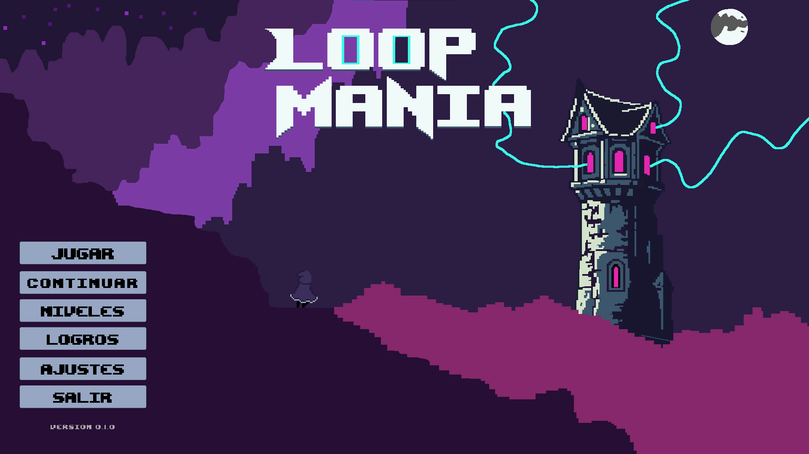
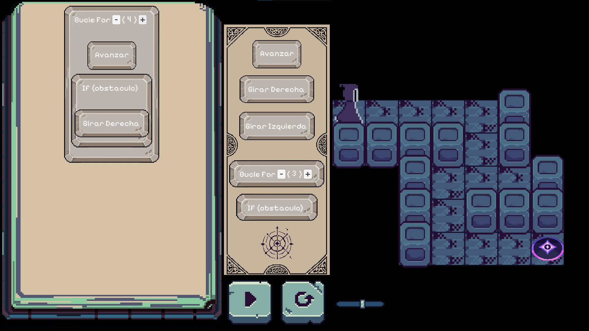

# Loop Mania

**Programa tus hechizos. Resuelve el camino. Conquista la torre.**

Loop Mania es un videojuego educativo de puzles en 2D que acerca los fundamentos de la programación mediante hechizos y desafíos de lógica. El jugador acompaña a un mago que debe ascender por una torre para demostrar su dominio de la magia y convertirse, por fin, en un verdadero hechicero.

Cada recorrido se resuelve construyendo un programa visual: arrastrar acciones al grimorio, ordenarlas, ejecutarlas y observar sus resultados. A medida que avanza la aventura, los movimientos individuales dan paso a **bucles, condicionales y combinaciones de bloques** que permiten expresar soluciones más eficientes.

Desarrollado con **Unity y C#**, con estética *pixel art*, interfaz en español y una experiencia para un jugador.



*Menú principal de Loop Mania, con la torre como escenario de la aventura.*

## Contenido

- [Aprender a programar con magia](#aprender-a-programar-con-magia)
- [Cómo se juega](#cómo-se-juega)
- [Hechizos y estructuras de control](#hechizos-y-estructuras-de-control)
- [Controles](#controles)
- [Progresión, estrellas y logros](#progresión-estrellas-y-logros)
- [Ejecutar el proyecto](#ejecutar-el-proyecto)
- [Organización del proyecto](#organización-del-proyecto)
- [Diseño de niveles](#diseño-de-niveles)
- [Estado del desarrollo](#estado-del-desarrollo)

## Aprender a programar con magia

La propuesta está orientada a quienes se inician en la programación. Los conceptos se presentan mediante acciones visibles sobre el escenario, sin necesidad de escribir código para jugar.

| Concepto | Aplicación en el juego |
| --- | --- |
| Secuencias | Organizar hechizos en el orden necesario para recorrer el mapa. |
| Bucles `for` | Repetir un conjunto de acciones con una cantidad configurable de iteraciones. |
| Condicionales `if` | Ejecutar acciones cuando se detecta un obstáculo delante del personaje. |
| Anidamiento | Colocar bloques dentro de otras estructuras para combinar comportamientos. |
| Depuración | Observar un intento, identificar el error y corregir la secuencia. |
| Optimización | Resolver el mismo recorrido con menos bloques. |

El error forma parte del aprendizaje: un intento permite contrastar lo que se esperaba del programa con lo que realmente hizo el personaje.

## Cómo se juega



*El grimorio reúne las instrucciones del programa; la página de hechizos ofrece los bloques disponibles y el escenario muestra el recorrido hasta la meta.*

1. **Inicia la partida.** En el primer acceso puedes introducir un nombre de jugador. Desde el menú principal, elige **Jugar**, **Continuar** o un nivel desbloqueado en el selector.
2. **Estudia el recorrido.** Identifica la posición del mago, la meta, los obstáculos y los abismos. Los giros siempre se interpretan respecto a la orientación del personaje.
3. **Abre la página de hechizos con `Tab`.** Arrastra los bloques disponibles hacia el **Grimorio Mágico**, donde se construye la secuencia del programa.
4. **Prepara la solución.** Coloca las acciones en orden. Cuando estén disponibles, añade bucles o condicionales y arrastra las acciones que deban ejecutarse dentro de ellos. Puedes retirar bloques llevándolos al **Sello de Anulación**.
5. **Ejecuta con `Espacio` o con el botón de ejecución.** Una flecha señala el bloque que se está ejecutando; el control de velocidad permite ajustar el ritmo de las acciones.
6. **Observa, corrige y vuelve a probar.** Si el mago cae al abismo o el programa termina sin alcanzar la meta, reinicia el intento con `T` para conservar los bloques y ajustar la solución.
7. **Completa el nivel y asciende.** Al llegar a la meta se muestran las estrellas obtenidas, la cantidad de bloques utilizados y el objetivo óptimo del nivel.

El tutorial inicial presenta el grimorio, la página de hechizos, la ejecución y la corrección de un programa. Más adelante se incorporan explicaciones específicas para los bucles y los condicionales.

## Hechizos y estructuras de control

| Bloque | Comportamiento |
| --- | --- |
| **Avanzar** | Desplaza al mago una casilla en la dirección hacia la que mira. Un muro bloquea el avance. |
| **Girar a la derecha** | Cambia la orientación del mago 90° hacia la derecha, sin desplazarlo. |
| **Girar a la izquierda** | Cambia la orientación del mago 90° hacia la izquierda, sin desplazarlo. |
| **Bucle `for`** | Repite los bloques de su interior. Los botones `+` y `−` ajustan la cantidad de repeticiones, con un mínimo de una. |
| **Condicional `if`** | Ejecuta sus bloques interiores si detecta un obstáculo o un abismo delante. Si la condición no se cumple, continúa con el siguiente bloque del programa. |

Por ejemplo, cuatro avances consecutivos pueden expresarse con un bucle:

```text
Repetir 4 veces
    Avanzar
```

Esta solución utiliza dos bloques: el bucle y la acción que contiene. El número de repeticiones no aumenta esa cantidad. También es posible introducir un condicional dentro de un bucle para comprobar el entorno en cada iteración.

Los hechizos disponibles dependen del nivel, de modo que cada estructura se introduce después de practicar los fundamentos anteriores.

## Controles

| Entrada | Acción |
| --- | --- |
| Ratón | Interactuar con los menús y arrastrar bloques al grimorio o al interior de una estructura. |
| `Tab` | Mostrar u ocultar la página de hechizos. |
| `Espacio` | Ejecutar el programa. |
| `T` | Reiniciar el intento conservando los bloques del grimorio. |
| `R` | Reiniciar el nivel y vaciar el grimorio. |
| `H` | Alternar la opacidad de la interfaz para facilitar la lectura del escenario. |
| `Esc` | Regresar al menú principal desde el nivel. |
| `+` / `−` del bucle | Aumentar o reducir sus repeticiones mediante los botones del bloque. |

Durante el tutorial inicial, los controles se habilitan según la acción que solicita cada paso. Para recibir las entradas de teclado dentro de Unity, la vista **Game** debe tener el foco.

## Progresión, estrellas y logros

La secuencia configurada en el proyecto introduce las mecánicas en tres etapas:

| Niveles | Enfoque |
| --- | --- |
| **1–5** | Secuencias con avances y giros; introducción al entorno mediante el tutorial inicial. |
| **6–10** | Incorporación del bucle `for` para reconocer patrones y reducir la cantidad de bloques. |
| **11–15** | Incorporación del condicional `if` y combinación de estructuras de control. |

Cada nivel completado otorga **entre una y tres estrellas**, según la cantidad de bloques utilizados respecto al objetivo definido para ese recorrido. El recuento incluye los bloques contenedores y los bloques anidados: se valora el tamaño del programa construido. Alcanzar el objetivo óptimo, o mejorarlo, concede tres estrellas.

El progreso se guarda localmente mediante `PlayerPrefs`: niveles desbloqueados, mejores estrellas por nivel, tutoriales vistos y logros. El menú incluye un **selector de niveles**, la opción **Continuar**, un **salón de logros** y ajustes de **volumen** y **pantalla completa**.

Los logros reconocen hitos como completar los primeros desafíos, utilizar bucles y condicionales, resolver un nivel con rapidez y acumular soluciones de tres estrellas.

### Registro de intentos

El juego registra los intentos en `log_loopmania.csv`. Cada entrada contiene la fecha y hora, el identificador del jugador, el nivel, los bloques disponibles, la secuencia construida, el resultado y el tiempo transcurrido desde el inicio del intento.

Este registro permite revisar las soluciones y observar cómo evoluciona la resolución de los desafíos. Al ejecutar desde el editor, el archivo se encuentra en la raíz del proyecto.

## Ejecutar el proyecto

### Requisitos

- **Unity Hub** y la versión de Unity indicada en [`ProjectSettings/ProjectVersion.txt`](ProjectSettings/ProjectVersion.txt).
- **Git**, si se desea clonar el repositorio desde la terminal.
- Conexión a Internet durante la primera apertura para que Unity restaure los paquetes del proyecto.
- Teclado y ratón para interactuar con el juego.

### Instalación y primera partida

1. Clona el repositorio:

   ```bash
   git clone https://github.com/Kiziio1/Loop-Mania.git
   ```

2. En **Unity Hub**, utiliza **Add / Añadir proyecto desde disco** y selecciona la carpeta que contiene `Assets`, `Packages` y `ProjectSettings`.
3. Abre el proyecto con la versión del editor indicada en `ProjectVersion.txt` y espera a que finalicen la importación y la compilación.
4. Abre la escena [`Assets/Scenes/MainMenu.unity`](Assets/Scenes/MainMenu.unity).
5. Pulsa **Play** en Unity y selecciona la vista **Game** para interactuar con el menú y comenzar la partida.

**La escena de entrada es `MainMenu`.** En ella se inicializan los gestores persistentes de progreso, registro y transiciones que utiliza la escena de juego.

Las dependencias se declaran en [`Packages/manifest.json`](Packages/manifest.json). Entre las tecnologías utilizadas están **Universal Render Pipeline con renderizador 2D**, **Unity Input System**, **Unity UI** y **TextMesh Pro**.

### Generar una compilación

El proyecto incluye un perfil en [`Assets/Settings/Build Profiles/Loop Mania.asset`](Assets/Settings/Build%20Profiles/Loop%20Mania.asset). En **File > Build Profiles**, comprueba que la lista de escenas incluya, en este orden:

1. `Assets/Scenes/MainMenu.unity`
2. `Assets/Scenes/GameLoop.unity`

Selecciona la plataforma de destino en **Build Profiles** e instala su módulo de compilación desde **Unity Hub** si es necesario. Después, genera el ejecutable desde el editor.

## Organización del proyecto

| Ruta | Contenido |
| --- | --- |
| [`Assets/Scenes/`](Assets/Scenes) | Menú principal y escena de juego. |
| [`Assets/Scripts/`](Assets/Scripts) | Ejecución de programas, comportamiento del personaje, bloques, interfaz, progreso y registro de intentos. |
| [`Assets/Niveles/`](Assets/Niveles) | Definiciones de nivel basadas en `ScriptableObject`. |
| [`Assets/Editor/`](Assets/Editor) | Herramienta visual para editar las cuadrículas de los niveles. |
| [`Assets/Prefabs/`](Assets/Prefabs) | Elementos reutilizables del escenario y de la interfaz. |
| [`Assets/Sprites/`](Assets/Sprites) | Recursos gráficos del juego. |
| [`Assets/Musica/`](Assets/Musica) y [`Assets/Sonidos/`](Assets/Sonidos) | Música y efectos de sonido. |
| [`Packages/`](Packages) | Dependencias del proyecto. |
| [`ProjectSettings/`](ProjectSettings) | Configuración del editor y del juego. |

La lógica principal se concentra en `GameManager.cs`, que coordina los niveles, los tutoriales, la ejecución y los resultados. `bloqueDeComando.cs` define los hechizos y su anidamiento; `PlayerController.cs` aplica las acciones al personaje; `AchievementManager.cs` conserva el progreso, y `LogManager.cs` escribe el registro de intentos.

## Diseño de niveles

Cada nivel se define mediante un recurso `LevelData`: dimensiones del mapa, distribución de casillas, posición inicial del personaje, estructuras permitidas y cantidad óptima de bloques.

Para trabajar con estos recursos desde Unity:

1. Crea un recurso desde **Create > Loop Mania > Nivel**, o selecciona uno existente en `Assets/Niveles`.
2. Configura sus dimensiones, la posición inicial, los bloques permitidos y el objetivo óptimo desde el Inspector.
3. Pulsa **Abrir Editor de Niveles Visual** para editar las casillas de la cuadrícula. La herramienta también está disponible en **Window > Loop Mania > Editor de Niveles**.
4. Incorpora el recurso a la lista `secuenciaDeNivel` del `GameManager` de la escena `GameLoop` para incluirlo en la progresión.

## Estado del desarrollo

Loop Mania se encuentra en fase de **prototipo en desarrollo**. La escena de juego referencia **15 definiciones de nivel**; la base implementada incluye programación visual, acciones de movimiento, bucles, condicionales, tutoriales, puntuación con estrellas, progreso local y menús.

El diseño y equilibrio de los desafíos, la presentación y la ampliación del contenido siguen en evolución. Las estructuras de datos también contemplan llaves y puertas como base para futuras mecánicas.
